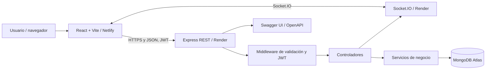
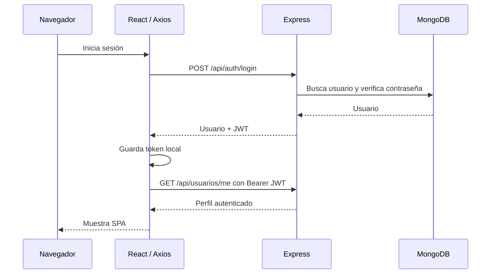
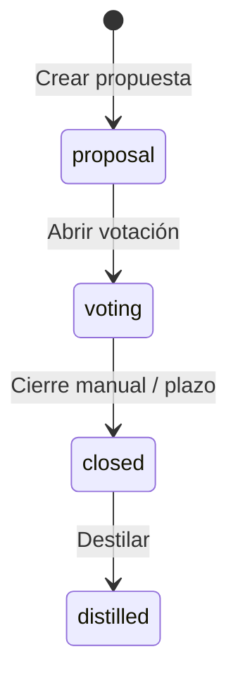

# Arquitectura de Potion Lab Beta

## Visión general

Potion Lab Beta es una SPA React conectada a una API Express, con persistencia en MongoDB Atlas y comunicación en tiempo real mediante Socket.IO.



## Límites y responsabilidades

| Capa | Responsabilidad |
| --- | --- |
| Frontend | Presentación, formularios, navegación, estado temporal, mensajes y solicitudes. |
| Rutas Express | Definir verbos HTTP, rutas y reglas de entrada. |
| Middleware | Autenticación JWT, validación de campos, control de errores y actualización de plazos. |
| Controladores | Orquestar solicitudes y emitir respuestas HTTP. |
| Servicios | Reglas de negocio de gremios, votos, plazos, resultados y destilación. |
| Mongoose / MongoDB | Modelos de usuarios, gremios y fórmulas; datos persistentes. |
| Socket.IO | Notificación de cambios para actualizar las vistas conectadas. |
| OpenAPI | Contrato público de los endpoints REST. |

## Autenticación



El token autentica las peticiones; los permisos reales deben verificarse en el servidor. Al recargar, el frontend intenta recuperar la sesión con el token existente. Cerrar sesión elimina el token del cliente, no modifica por sí solo el estado de la base de datos.

## Ciclo de una fórmula



- `proposal`: propuesta creada, todavía sin votación activa.
- `voting`: los participantes pueden registrar votos según permisos y reglas.
- `closed`: se computan resultados y desempates.
- `distilled`: se registra la poción obtenida, que puede consultarse en el Grimorio.

Las transiciones y restricciones las aplica el backend. No se debe forzar un estado desde el cliente mediante manipulaciones locales.

## Votación y resultados

Cada fórmula contempla categorías de **ingrediente**, **método** y **frasco**. El sistema pondera votos según especialidad, puede aplicar el veto autorizado y resuelve empates conforme a las reglas del negocio. Los resultados definitivos se producen en el servidor y se guardan de manera persistente. Los avisos por Socket.IO indican a los clientes que deben actualizar sus datos.

## Estructura del repositorio

```text
Potion-Lab-Beta/
├── backend/
│   ├── config/
│   ├── controllers/
│   ├── docs/           # Swagger y OpenAPI
│   ├── middleware/
│   ├── models/
│   ├── routes/
│   ├── services/
│   ├── sockets/
│   └── utils/
├── frontend/           # Código React, tras refactor local
│   ├── components/
│   ├── context/
│   ├── hooks/
│   ├── pages/
│   ├── services/
│   └── utils/
├── docs/               # Guías de arquitectura, frontend y pruebas
├── public/             # Recursos de Vite
├── index.html
├── package.json
└── vite.config.js
```

**Sincronización de ramas:** el cambio local de `src/` a `frontend/` debe confirmarse en un commit independiente antes de considerar este árbol como el estado publicado. La presente entrega modifica solamente documentos.

## Despliegue

- Frontend público: https://potionlab.netlify.app/
- Backend público: https://potion-lab-beta.onrender.com
- Swagger UI: https://potion-lab-beta.onrender.com/api/docs
- Salud: https://potion-lab-beta.onrender.com/api/salud

La compilación de Vite se ejecuta desde la **raíz del repositorio**, con salida `dist/`. El backend se ejecuta desde `backend/`. La base de datos de producción no debe utilizarse para pruebas destructivas o cargas de semilla repetidas.

## Decisiones de diseño

- Arquitectura por capas para separar interfaz, HTTP y lógica de dominio.
- REST como fuente de verdad; Socket.IO solamente para sincronización.
- JWT validado por middleware para las rutas protegidas.
- OpenAPI como documentación interactiva del servidor y Markdown como documentación de frontend y arquitectura.

Consultar [FRONTEND.md](FRONTEND.md), [PRUEBAS.md](PRUEBAS.md) y [documentación de la API](API.md).
