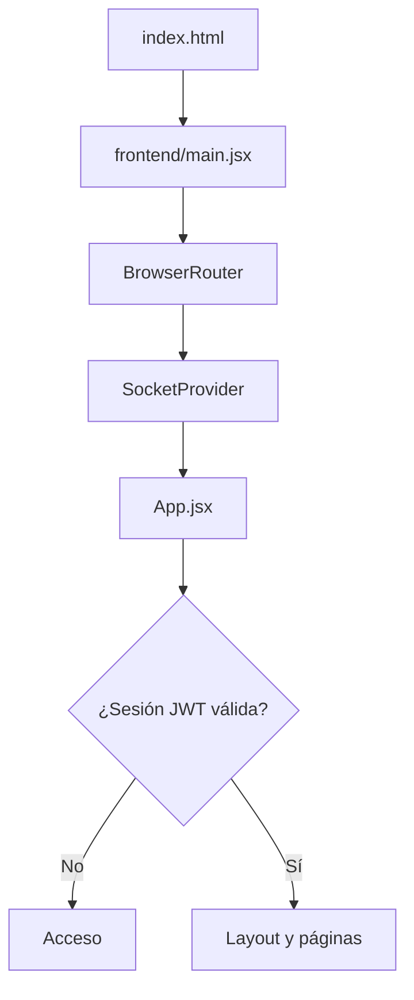
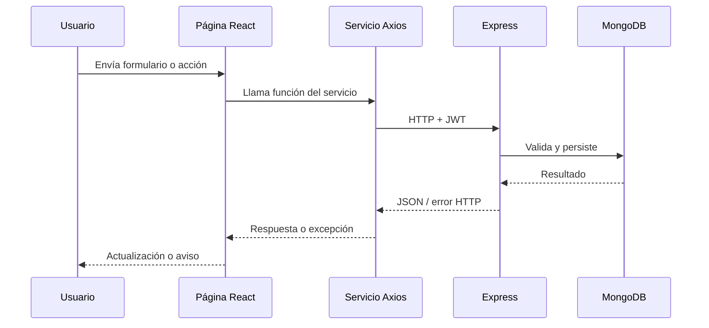

# Guía técnica del frontend — Potion Lab Beta

> Documento de referencia para comprender, ejecutar y mantener la aplicación React. La estructura descrita corresponde a la reorganización local de `src/` a `frontend/`; comprueba que ese refactor esté incorporado a GitHub antes de interpretar las rutas como definitivas.

## Tecnologías

- **React 19**: componentes funcionales, hooks y estado de interfaz.
- **Vite 8**: desarrollo y generación de `dist/`.
- **React Router DOM 7**: navegación de la SPA.
- **Axios**: cliente HTTP para el backend.
- **Socket.IO Client 4**: sincronización en tiempo real.
- **React Icons y CSS**: presentación.
- **Oxlint**: análisis estático.

## Organización del código

| Ruta tras la reorganización | Responsabilidad |
| --- | --- |
| `frontend/main.jsx` | Montaje de React, `StrictMode`, `BrowserRouter` y `SocketProvider`. |
| `frontend/App.jsx` | Sesión, coordinación de datos, acciones de usuario y definición de rutas. |
| `frontend/components/authentication/` | Formulario de acceso y registro. |
| `frontend/components/common/` | Avisos y componentes de interfaz reutilizables. |
| `frontend/components/formula/` | Tarjetas, paneles de fórmula y votación. |
| `frontend/components/gremio/` | Componentes de gremios y gestión de integrantes. |
| `frontend/components/layout/` | Layout principal, navegación y encabezado. |
| `frontend/context/` | `UsuarioContext` y `SocketContext`. |
| `frontend/hooks/` | `useUsuario`, acceso reutilizable al contexto de usuario. |
| `frontend/pages/` | Pantallas asociadas a rutas. |
| `frontend/services/` | Cliente Axios y funciones de acceso a la API; cliente Socket.IO si se aplica el traslado local. |
| `frontend/data/constants.js` | Constantes y catálogos estáticos; no reemplazan la base de datos. |
| `frontend/utils/` | Normalización y funciones auxiliares. |
| `frontend/styles/` | Hojas CSS organizadas por responsabilidad. |

**Importante:** la raíz de **Vite sigue siendo la raíz del repositorio**: `index.html`, `package.json`, `vite.config.js` y `public/` permanecen allí. Renombrar solo `src/` no supone cambiar el directorio base de Netlify.

## Recorrido de arranque



`App.jsx` recupera el usuario desde `/api/usuarios/me` cuando encuentra el JWT guardado; mientras verifica la sesión muestra un estado de carga. Si no hay usuario autenticado, muestra la pantalla de acceso.

## Estado global y contextos

- **`UsuarioContext`** comparte `usuarioActivo`, `cerrarSesion` y `guardarPerfil` con componentes consumidores.
- **`useUsuario`** encapsula `useContext(UsuarioContext)` y evita imports repetidos.
- **`SocketContext`** ofrece el socket y un indicador de conexión; registra y limpia listeners de conexión en su efecto.
- **Estado local en `App.jsx`**: usuarios, gremios, fórmulas, Grimorio, carga y mensajes de error.

Los datos funcionales proceden del backend y MongoDB, no de un conjunto de mocks del frontend. Las constantes de especialidades y las cuentas de demostración son datos estáticos de presentación.

## Acceso a la API

`services/api.js` configura Axios con:

```js
baseURL: import.meta.env.VITE_API_URL || "http://localhost:3000/api"
```

Un interceptor lee `potionlab-token` de `localStorage` y adjunta `Authorization: Bearer <JWT>` cuando existe una sesión. El backend sigue siendo responsable de validar identidad, roles, fechas y estados; ocultar botones en React no constituye una medida de autorización.

Flujo típico de una acción:



## Tiempo real

Socket.IO complementa —no sustituye— las peticiones REST. El cliente se conecta mediante `VITE_SOCKET_URL`, y la aplicación escucha eventos para refrescar las fórmulas tras modificaciones relevantes. Las votaciones deben persistirse primero en el backend.

## Rutas de la SPA

| Ruta | Función |
| --- | --- |
| `/` | Resumen y métricas |
| `/gremios` | Directorio de gremios |
| `/gremios/:gremioId` | Detalle y administración de un gremio |
| `/formulas` | Catálogo de fórmulas |
| `/formulas/nueva` | Creación de propuestas |
| `/formulas/:formulaId` | Detalle y votación |
| `/grimorio` | Historial de pociones |
| `/ranking` | Clasificación |
| `/perfil` | Perfil del usuario |

`public/_redirects` permite que las rutas cliente funcionen al recargar en Netlify.

## Desarrollo local

En la **raíz** del repositorio:

```powershell
npm install
npm run dev
npm run build
npm run lint
```

Configuración local en `.env` (no versionar):

```dotenv
VITE_API_URL=http://localhost:3000/api
VITE_SOCKET_URL=http://localhost:3000
```

En producción ambas variables deben señalar al backend de Render; las variables `VITE_*` se incorporan al bundle y **no son secretas**. No colocar credenciales ni `JWT_SECRET` en el frontend.

## Convenciones para cambios

1. Mantener componentes visuales en `components/` y pantallas en `pages/`.
2. Ubicar peticiones HTTP en `services/`, evitando URLs de API dispersas.
3. Centralizar reglas de negocio y permisos definitivos en el backend.
4. Mantener formularios controlados y gestionar estados de carga y error.
5. Comprobar `npm run build` y el flujo afectado antes de publicar.

Para los flujos generales, consultar [ARQUITECTURA.md](ARQUITECTURA.md) y [PRUEBAS.md](PRUEBAS.md).
